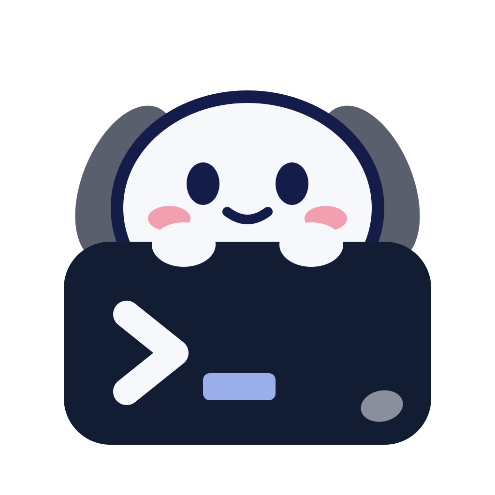
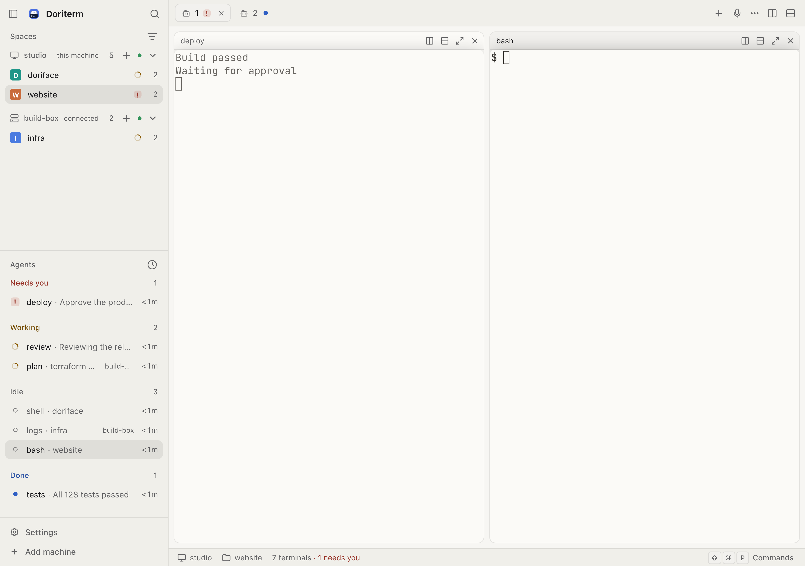
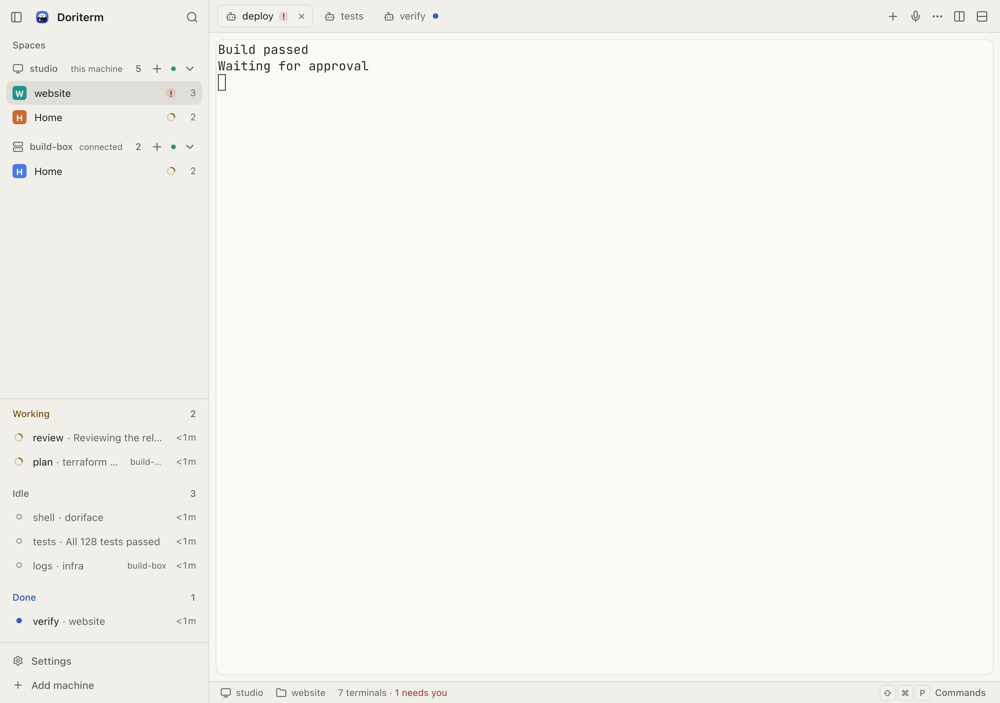

<p align="center">
  <picture>
    <source media="(prefers-color-scheme: dark)" srcset="apps/web/brand/doriterm-mark-dark.svg" />
    
  </picture>
</p>

<h1 align="center">Doriterm</h1>

<h3 align="center">Your devices. One terminal.</h3>

<p align="center">
  Every machine you own, linked through an end-to-end encrypted mesh.
</p>

<p align="center">
  <a href="https://doriterm.com">doriterm.com</a> ·
  <a href="#install">install</a> ·
  <a href="#pairing-and-how-the-relay-fits">how the relay fits</a> ·
  <a href="#a-mesh-of-your-machines">mesh</a> ·
  <a href="#security">security</a> ·
  <a href="CONTRIBUTING.md">contributing</a> ·
  <a href="docs/architecture.md">architecture</a>
</p>

<p align="center">
  <a href="https://github.com/sisyphuslabs/doriterm/actions/workflows/ci.yml"></a>
  <a href="https://get.doriterm.com"></a>
  <a href="https://get.doriterm.com/stats/downloads"></a>
  <a href="LICENSE"></a>
</p>

<p align="center">
  <b>0</b> keys at the relay that open your sessions &nbsp;·&nbsp; <b>8</b> characters to pair, behind CPace &nbsp;·&nbsp;
  <b>1</b> sidebar for every machine
</p>

<picture>
  <source media="(prefers-color-scheme: dark)" srcset="docs/design/app/workspace-1440-4k-night.png" />
  
</picture>

---

**Doriterm puts the shells and coding agents on your machines in a browser tab, a phone and a desktop app.** A host runs
beside [herdr-core](https://github.com/herdrdev/herdr-core) (`hc`) where the work actually happens, your machines link into
one mesh, and every session is encrypted end to end with Noise: the relay in the middle forwards ciphertext and holds no key
that opens it.

Because that host pipes `hc`'s own JSON-RPC and framed terminal protocol through byte for byte, every `hc` feature works
without Doriterm re-implementing it — and what crosses the network is a Noise session, not a remote-desktop stream.

## What you get

- **Your terminals, on every screen.** The browser tab, the phone's home screen and the desktop app open the same workspace: the
  same tabs, panes and layout.
- **Agents that say when they need you.** The sidebar groups every session as _needs you_, _working_, _idle_, _done_ or
  _offline_, so you read the list instead of cycling through panes looking for the one that stopped.
- **One window, many machines.** Machines in your [mesh](#a-mesh-of-your-machines) show up in each other's sidebar, and a host
  added over ssh or through the relay with `hc machine add --via` appears next to your local ones as `b/t1`, `b/t2`, … with its
  own reconnect.
- **Machines that vouch for each other.** Membership is a set of records every member signs with its Ed25519 key and syncs
  over the same encrypted relay — no ssh, no open port, and one record revokes a machine everywhere.
- **An encrypted pipe, not a proxy.** Each client holds its own Noise session with the host: IKpsk2 with the pairing code's
  preshared key for the first one, IK from then on. The relay forwards records it cannot read.
- **A real terminal.** libghostty-vt compiled to WebAssembly from Ghostty v1.4.0, with the wasm build's provenance checked in
  CI, so cells, fonts and escape sequences behave like the terminal you already use.
- **A phone that can drive a terminal.** A key bar for ctrl, shift, tab, esc and the arrows, a paste button, and IME composition
  that reaches the terminal ahead of any key, chord or paste, so a syllable still being composed is not split by it.
- **Installs and stays installed.** The desktop app starts the host and `hc` on the computer it runs on, starts the host again
  if it stops, and installs herdr-core for this user when it is missing or too old.

| Needs you, day theme                                                                                                                             | A terminal on a phone                                                                                                                                           |
| ------------------------------------------------------------------------------------------------------------------------------------------------ | --------------------------------------------------------------------------------------------------------------------------------------------------------------- |
|  |  |

## Install

Three pieces: a **host**, the machine whose terminals you want; a **client**, which is the browser, a phone or the desktop
app; and the **relay** between them, which is already deployed. The shortest path is three steps:

1. **Start a host** on the machine whose terminals you want. The desktop app does it for you when it opens, or run
   [`doriface-host`](#a-host-on-the-machine-with-the-terminals) from this repository.
2. **Open a client**: the desktop app, or the web app at [app.doriterm.com](https://app.doriterm.com);
   [doriface.omo.dev](https://doriface.omo.dev) keeps serving the same build while the move completes.
3. **Pair it** with the host — scan the QR code the host prints, or open the link it prints, and confirm the fingerprint it
   shows. [Pairing, and how the relay fits](#pairing-and-how-the-relay-fits) is the whole of it.

[Getting started](docs/getting-started.md) walks these steps with the desktop app and a phone, button by button.

### The desktop app

[get.doriterm.com](https://get.doriterm.com) carries the app for every supported platform, one link each that always
answers with the current release (every release is also on [GitHub Releases](https://github.com/sisyphuslabs/doriterm/releases/latest)):

| Platform                          | Download                                                                                                                                                                                                                                           |
| --------------------------------- | -------------------------------------------------------------------------------------------------------------------------------------------------------------------------------------------------------------------------------------------------- |
| macOS, Apple silicon              | [dmg](https://get.doriterm.com/dl/mac-arm64.dmg), [zip](https://get.doriterm.com/dl/mac-arm64.zip)                                                                                                                                                 |
| macOS, Intel                      | [dmg](https://get.doriterm.com/dl/mac-x64.dmg), [zip](https://get.doriterm.com/dl/mac-x64.zip)                                                                                                                                                     |
| Windows, Intel or AMD (x64)       | [x64 installer](https://get.doriterm.com/dl/win-x64.exe)                                                                                                                                                                                           |
| Windows on ARM (arm64)            | [arm64 installer](https://get.doriterm.com/dl/win-arm64.exe)                                                                                                                                                                                       |
| Linux, x64 and arm64              | [x64 AppImage](https://get.doriterm.com/dl/linux-x64.AppImage), [arm64 AppImage](https://get.doriterm.com/dl/linux-arm64.AppImage), [x64 deb](https://get.doriterm.com/dl/linux-x64.deb), [arm64 deb](https://get.doriterm.com/dl/linux-arm64.deb) |
| The web client, to serve yourself | [zip](https://get.doriterm.com/dl/web.zip)                                                                                                                                                                                                         |

The macOS app has been signed with a Developer ID certificate and notarized since v0.1.1, and its disk image is stapled; v0.1.0
was only ad-hoc signed, so macOS blocks its first open until you choose **Open Anyway** in System Settings > Privacy &
Security, or run `xattr -dr com.apple.quarantine /Applications/Doriterm.app`. The Windows installers are not code signed yet, so
SmartScreen warns about an unknown publisher: choose **More info**, then **Run anyway**.
[`SHA256SUMS.txt`](https://get.doriterm.com/dl/SHA256SUMS.txt) lists every file's checksum, and `SHA256SUMS.txt.sig` beside
it is its Ed25519 signature by the release key in `packages/crypto/src/release.ts`. The app updates itself from the same
host: Settings > This device > Update channel picks Stable or Beta.

On Windows, check **Settings > System > About > System type** before downloading. The arm64 setup requires an ARM64
machine and refuses x64 Windows. The x64 setup also works on Windows on ARM through x64 emulation; prefer the native arm64
setup there.

The desktop app starts a host on the computer it runs on, so that computer's terminals appear as soon as it opens.

### In a browser

The web client is the same app and needs no install. It is served at [app.doriterm.com](https://app.doriterm.com), and
[doriface.omo.dev](https://doriface.omo.dev) keeps serving the same build while the move completes. Use your browser's "install" or "add to home
screen" if you want it in a window of its own; an installed PWA opens in its own window and precaches its shell, so a dropped
network does not empty the window. A release build reaches your machines through the relay only — a development build
(`bun run --cwd apps/web dev`) also offers "Loopback dev" in Settings > This device, with the token from
`doriface-host --print-token`.

Chrome or Edge 119, Safari 17.4 (iOS 17.4), or Firefox 121 and newer. An older browser gets an "Update your browser" screen
naming what it lacks instead of the app (`apps/web/src/baseline.ts`).

### A host, on the machine with the terminals

On Linux or macOS, one command installs it:

```sh
curl -fsSL https://get.doriterm.com | sh
```

It downloads `doriface-host` into `~/.local/bin`, checks it against the release's `SHA256SUMS.txt` and that file's
signature, installs
herdr-core when `hc` is missing, runs the host as a user service at the highest priority a user service can have
(systemd `--user` on Linux, an `Interactive` LaunchAgent on macOS), then prints a QR code, a link and an 8-character
code to pair your first device. `sh -s -- --help` lists the options; `--uninstall` removes the service and the binary and
keeps the host's keys and paired devices. To add a computer to a host you already use, open **Add a machine** in the
app: it shows this same line with the link in `DORIFACE_JOIN='<link>'` before `sh`, which installs the host there and
joins it to this host's mesh, so its terminals show in the app. Pasted into a shell, the line keeps the link off every
command line the install runs (though the shell's history keeps the line). On Windows, the desktop app carries the host.
The installer ships from the first release after v0.1.2.

From this repository, with [Bun](https://bun.sh) installed:

```sh
git clone https://github.com/sisyphuslabs/doriterm && cd doriterm
bun install
bun run --cwd apps/host start --print-token   # the gateway on 127.0.0.1:7766, and its client token
```

`doriface-host --install-hc` installs or updates herdr-core in `~/.local/bin` from its checksummed release, then exits. The host
keeps its keys and the devices it paired in `$XDG_STATE_HOME/doriface-host` (or `--state-dir`), and `doriface-host devices
list` and `doriface-host devices revoke <id>` manage what is paired.

To keep a host running on every machine you own, as a systemd user unit on Linux or a LaunchAgent on macOS that survives
logouts and reboots, follow [docs/install.md](docs/install.md), or hand the
[doriterm-setup skill](skills/doriterm-setup/SKILL.md) to a coding agent. Its `bun apps/host/scripts/setup/cli.ts install`
writes the service, installs herdr-core if needed, waits for the relay and is safe to re-run. The service keeps its own state
dir (`~/.local/state/doriface-host-mesh`), so it never shares keys or devices with the desktop app's own host.

## Pairing, and how the relay fits

A client reaches another machine's host through the relay, in a Noise session the relay cannot read:

```
browser / PWA / desktop ──┐                         ┌── doriface-host ── hc connect ── herdr-core
                          ├─ Noise (end-to-end) ────┤
     relay-doriface.omo.dev (sees ciphertext only) ─┘
```

Pairing is one step on the host and one on the client:

```sh
doriface-host pair                                     # prints a link, a QR code, a typed code and the fingerprint
# on the phone: scan the QR code, or open the link
doriface-host connect '<link>' < /dev/null             # on another computer, once
#   with the typed code instead: doriface-host connect <code> --fingerprint '<first 4 groups the host printed>'
```

The typed code is 8 characters, single use, and dies after 10 minutes; the first session confirms the host's fingerprint
before the device is trusted. Re-pairing a host whose key or relay changed is refused unless you add `--replace` after
checking the change.

Other machines join the same way, through the same relay:

```sh
hc machine add --via 'doriface-host connect <B hostId>' --name b   # B's terminals appear as b/t1, b/t2, …
```

Every one of those paths goes through the relay: the direct path is off by decision (#2070), so no client dials a host's address,
and the host's `--lan-listen` exists for tests only. On the same machine the host
serves a token-gated, loopback-only `ws://127.0.0.1:7766/v1/hc`, which is how the desktop app talks to its own local host. The
host never parses what `hc` says — it pipes the stream — so the client SDK speaks herdr-core's protocol itself and a future
native app can reuse it. The full design is in [docs/architecture.md](docs/architecture.md), and the wire contract every package
is built against is [docs/transport.md](docs/transport.md).

## A mesh of your machines

Put a laptop, a build box and a VPS in one mesh and each one lists the others as machines in its sidebar, with their spaces and
agents under their names. Joining needs no ssh and no open port: it runs the same pairing handshake through the same relay.

```sh
doriface-host mesh pair                       # on a member: invite a machine (a link and a code)
doriface-host mesh join '<link or code>'      # on the new machine: ask to join
doriface-host mesh join --from-file <file>    # …the same, reading the link or code from a file, off the command line
doriface-host mesh status                     # who is in the mesh (--json for scripts)
doriface-host mesh revoke <member>            # remove a member on every machine
doriface-host mesh revoke --compromised <member>   # …and everyone it admitted
```

The setup skill's `invite --out <file>` and `join --from <file>` wrap `mesh pair --auto` and `mesh join` and keep the
single-use link in a 0600 file instead of on screen ([docs/install.md](docs/install.md)).

A machine joins only after you approve it on the member it dialed — in that member's terminal, or on a device paired to it —
unless the invite was opened with `--auto`. Membership is a grow-only set of signed, hash-linked records; every member keeps
the whole set and syncs it over Noise sessions through the relay, which stores none of it and can forge none of it. A revoke
closes the revoked keys' sessions on every member and refuses those keys on every path; `mesh rename` and `mesh leave` cover
the rest. The record format and its conflict rules are in [docs/transport.md](docs/transport.md).

## Security

Every byte between a client and a host — through the relay, or over `/v1/e2ee` — is Noise-authenticated:
`Noise_IKpsk2_25519_ChaChaPoly_BLAKE2s` when the pairing code's preshared key is used, `Noise_IK_25519_ChaChaPoly_BLAKE2s`
after that, with a ChaCha20-Poly1305 record layer that rekeys every 2^20 messages.

- **The relay forwards records it cannot read.** It can drop, replay or reorder them — a delayed record in order fails
  nothing — and when it does, the session fails: it cannot read or forge `hc` bytes, impersonate either side, or splice two
  sessions. Its leverage is the pairing window: the device name is in IKpsk2 msg1, which a relay that answers the pairing
  lookup itself can read, and a typed code can be tried online a bounded number of times before the host retires it.
- **What the relay does see:** the `hostId`, source addresses, timing and sizes, session ids, the pairing slots and their
  public keys, the device name in the first IKpsk2 message when it answers that lookup itself, and — for a session a host
  proves with a relay pass, which is the machine-to-machine dials — which host dialled which, so it learns the shape of your
  mesh. Nothing a terminal prints.
- **Keys stay on your machines.** The host's Ed25519 identity and X25519 static live in its state directory, mode 0600, beside
  the paired-device store; the web client's device key is non-extractable wherever WebCrypto allows, which stops export but not
  same-origin use of the key.
- **No plaintext listener.** `/v1/hc` is loopback-only unless you pass `--unsafe-listen`, and its token is compared in constant
  time. The LAN listener serves `/v1/e2ee` and never plaintext `/v1/hc`.
- **No telemetry in the default build.** The reference relay keeps anonymous daily counts and, as its only per-host rows,
  each month's mesh pool pseudonyms (kept until day 7 of the following month), and sends numbers only to its operator's product analytics ([`docs/transport.md`](docs/transport.md), Relay passes).
- **Out of scope:** a host or a client compromised while it runs, and keystroke timing — traffic is not padded.

The boundaries, and the citation for each, are in [docs/architecture.md §12](docs/architecture.md#12-security-model).

## Status

This table describes `dev`. [Download the latest release](https://get.doriterm.com).

| Piece                                        | State                                                                                                                                                                                                                                                                                                                                                                                                                                                                                                                                        |
| -------------------------------------------- | -------------------------------------------------------------------------------------------------------------------------------------------------------------------------------------------------------------------------------------------------------------------------------------------------------------------------------------------------------------------------------------------------------------------------------------------------------------------------------------------------------------------------------------------- |
| Host gateway, byte-for-byte `hc` passthrough | works                                                                                                                                                                                                                                                                                                                                                                                                                                                                                                                                        |
| Web client and installable PWA               | works: through the relay once paired, and installable to a home screen; a phone scans the pairing QR code to open its pair page. A development build also offers "Loopback dev" in Settings > This device, with the token from `doriface-host --print-token`; a release build connects through the relay only                                                                                                                                                                                                                                |
| Desktop app ("Use this computer")            | works: starts the host and `hc` on this computer and attaches terminals, starts the host again if it stops ([#525](https://github.com/sisyphuslabs/doriterm/pull/525)), can install herdr-core from the app, for this user only, when it is missing or too old ([#417](https://github.com/sisyphuslabs/doriterm/pull/417)), and offers this computer to a phone or another computer from Settings > Machines > Connect a machine > **Pair a device**, and again on This device ([#614](https://github.com/sisyphuslabs/doriterm/issues/614)) |
| Terminal rendering with libghostty           | works (Ghostty v1.4.0)                                                                                                                                                                                                                                                                                                                                                                                                                                                                                                                       |
| End-to-end encryption                        | works: Noise IK / IKpsk2 between every client and host ([#7](https://github.com/sisyphuslabs/doriterm/pull/7))                                                                                                                                                                                                                                                                                                                                                                                                                               |
| Pairing a device                             | works: an 8-character code protected by CPace, or a one-tap link ([#7](https://github.com/sisyphuslabs/doriterm/pull/7))                                                                                                                                                                                                                                                                                                                                                                                                                     |
| Public relay `relay-doriface.omo.dev`        | deployed: every `hc` method family and bulk traffic, ciphertext only ([#17](https://github.com/sisyphuslabs/doriterm/issues/17), [#26](https://github.com/sisyphuslabs/doriterm/pull/26), [#28](https://github.com/sisyphuslabs/doriterm/pull/28))                                                                                                                                                                                                                                                                                           |
| Other machines through the relay             | works: `hc machine add --via 'doriface-host connect <host>'`, one machine per pairing ([#30](https://github.com/sisyphuslabs/doriterm/pull/30))                                                                                                                                                                                                                                                                                                                                                                                              |

## Development

Requires [Bun](https://bun.sh) 1.4.4 or newer, and [herdr-core](https://github.com/herdrdev/herdr-core) (`hc`) 0.1.20 on
`PATH` to run the host, the desktop app, `bun run check` and the end-to-end tests. Starting on a machine with neither,
follow [CONTRIBUTING.md, "From zero"](CONTRIBUTING.md#from-zero): every step is public, and the `From zero` workflow
runs it as written on a clean runner with no secrets.

```sh
bun install
bun run check                                 # typecheck, lint, format check, API codegen check, tests
bun run --cwd apps/host start --print-token   # the host gateway on 127.0.0.1:7766; prints the client token
bun run --cwd apps/web dev                    # the web client
bun run --cwd apps/desktop start              # the desktop app
bun run --cwd packages/ui showcase            # every component and screen mockup
bun run capture:readme                        # the README's app screenshots, 1280x900 CSS at 3x (3840x2700)
```

`bun run --cwd apps/web test:e2e` and `bun run --cwd apps/desktop test:e2e` run the Playwright suites against a real `hc`.
`bun run relay:test` runs `tests/relay` against the private relay at the commit `relay-pin.json` names: it clones it into
`.relay` when `RELAY_REPO` names the relay's repository and your git credentials can read it, and otherwise says so and stops.
`bun run check` does not need it. `bun run relay:dev` serves that relay locally.

Pull requests into `dev` are gated by `Check`, `Relay e2e` and `Web e2e`. [CONTRIBUTING.md](CONTRIBUTING.md) covers what each
one runs, and what a pull request from a fork does about `Relay e2e`, which needs a secret that forks never receive. The
platform jobs — `Desktop`, `Desktop (macOS)`, `Windows private state` on both architectures — run after the merge, on the push
to `dev`, and never on a pull request; `Ghostty wasm provenance` runs on every event.

## Contributing

Issues and pull requests are welcome. Changes land on `dev` through a pull request that passes `Check`, `Relay e2e` and
`Web e2e`; commits carry one meaning each, in the imperative (`fix(web): …`). Read [CONTRIBUTING.md](CONTRIBUTING.md) before
opening one — it explains what each check runs, how a pull request from a fork gets its `Relay e2e` run inside this
repository, and why a change to `.github/workflows/` needs to be its own pull request.

## Releases

[Releases](https://github.com/sisyphuslabs/doriterm/releases), mirrored to [get.doriterm.com](https://get.doriterm.com)
([docs/releasing.md](docs/releasing.md)), carry the desktop app for macOS (Apple silicon and Intel: dmg
and zip), Windows (x64 and arm64: installer exe) and Linux (x64 and arm64: AppImage and deb), the web client and PWA as a zip
of static files, and `SHA256SUMS.txt`.

The [release workflow](.github/workflows/release.yml) builds every file on GitHub-hosted runners. The version comes from
`apps/desktop/package.json`:

1. Set `version` there and merge it.
2. Push the tag: `git tag vX.Y.Z && git push origin vX.Y.Z`. The workflow builds everything into a draft release, launches the
   uploaded Linux AppImage and macOS app, installs the Windows installer, then publishes the release. Notes come from the
   `## vX.Y.Z` section of `CHANGELOG.md`, and a tag whose section is missing or empty fails before any build.

A tag that does not match `apps/desktop/package.json` fails the run. A prerelease of that version, such as `vX.Y.Z-rc.1`, is
accepted and published as a prerelease. To try the pipeline without publishing, run the workflow from the Actions tab with
that version plus a prerelease suffix, such as `0.1.2-rc.1`: it builds the same files into a draft release and leaves it a
draft.

## Design

The design system lives in [DESIGN.md](DESIGN.md): herdr-compatible themes, tokens, the component set in `packages/ui`, the
accessibility rules every theme is tested against, and a brief for every screen.

## License

[AGPL-3.0](LICENSE)
