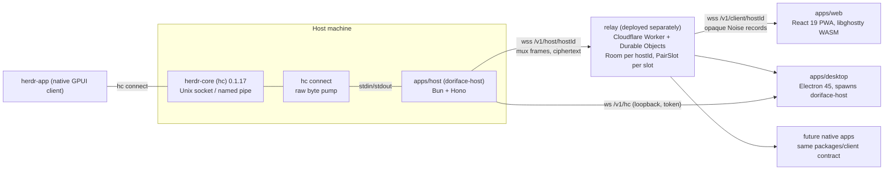

# Doriterm architecture

Decision-complete big picture for the plan and the implementation. Written 2026-11-03 from the research wave and the repository. Every claim is tagged **SOURCE** (the cited bytes or page were read in this session) or **INFERRED** (a design conclusion). Where the verification pass found a handoff's citations unopenable, the claim is carried as **UNPROVEN** and is never used as a load-bearing fact.

Citation bases. `BASE:path:line` names a file in that tree. `REPO` is this repository. `CRYPTO`, `RELAY` and `GHOSTTY` were feature branches that were still in review when this was written, so those paths existed on their branches; `CRYPTO` and `GHOSTTY` landed in `dev` when their branches merged, and `RELAY` is the exception below. `CORE`, `APP` and `T3` are public upstream repositories pinned by commit. `RELAY` is the relay server's own private repository: `apps/relay` moved there with its history, its files sit at that repository's root, and `RELAY:apps/relay/...` citations name those files. The relay server is deployed separately from this repository; its public contract is `docs/transport.md`, and `tests/relay` runs this repository's host and client against the private relay at the commit `relay-pin.json` pins.

**What SOURCE means here.** A SOURCE tag says the cited bytes were read while writing this document. Citations into `REPO` can be checked in this repository. Citations into `CORE`, `APP` and `T3` can be checked at the pinned public commit. Citations of the form research note `<name>` point at working notes that are not published, so those claims are external references a reader cannot check independently; nothing load-bearing rests on them alone.

| Base       | Tree                       | What it is                                                                                     |
| ---------- | -------------------------- | ---------------------------------------------------------------------------------------------- |
| `REPO`     | this repository            | Doriterm `dev` (public repo, AGPL-3.0)                                                         |
| `CRYPTO`   | branch `feat/crypto-e2ee`  | `packages/crypto` and the host's `/v1/e2ee`, in review                                         |
| `RELAY`    | private repository         | `apps/relay` at its root, deployed separately                                                  |
| `GHOSTTY`  | branch `feat/ghostty-wasm` | `packages/ghostty-wasm`, in review                                                             |
| `DESKTOP`  | this repository            | `apps/desktop` (merged)                                                                        |
| `CONTRACT` | `docs/transport.md`        | transport contract v1.6 (binding); bare line numbers in older section 6 rows were read at v1.2 |
| `CORE`     | `herdr-core@b63ecbd`       | herdr-core @ `b63ecbd` (`v0.1.17-9`)                                                           |
| `APP`      | `herdr-app@f6fe216`        | herdr-app @ `f6fe216`                                                                          |
| `T3`       | `t3code@57cd0590`          | t3code @ `57cd0590` (reference web/desktop stack)                                              |

Versions are from research note `stack-versions` (npm registry, 2026-11-03, SOURCE; `@wterm/*` re-read 2026-11-06): bun 1.4.4, typescript 7.0.2, react 19.3.1, vite 8.3.5, @tailwindcss/vite 4.3.4, hono 4.13.16, electron 45.2.1, electron-builder 26.18.0, wrangler 4.156.2, @cloudflare/workers-types 5.20261102.1, vite-plugin-pwa 2.0.0, workbox-window 7.4.1, @base-ui/react 1.9.0, lucide-react 1.66.0, @noble/{curves,ciphers,hashes} 2.4.0, @playwright/test 1.64.1, oxlint 1.90.0, oxfmt 0.75.0, knip 6.44.1, @wterm/{react,dom,ghostty} 0.5.9, @tanstack/react-router 1.170.46. The repository pins the same values (`REPO:package.json:19-28`, `REPO:apps/web/package.json:12-25`, SOURCE).

## 1. Goals and non-goals

| Goals                                                                                                                                                                                             | Non-goals                                                                                                                                                      |
| ------------------------------------------------------------------------------------------------------------------------------------------------------------------------------------------------- | -------------------------------------------------------------------------------------------------------------------------------------------------------------- |
| A web, PWA and desktop face for herdr-core that passes `hc`'s own JSON-RPC + framed protocol through untouched, so every `hc` method works with no translation layer (`REPO:README.md:5`, SOURCE) | A second runtime: Doriterm never owns a PTY, never parses terminal output on the host, never re-implements an `hc` method (INFERRED from the passthrough rule) |
| End-to-end encryption between device and host; the public relay sees ciphertext only (`CONTRACT:5-8`, `:45`, SOURCE)                                                                              | Relay-side accounts, entitlements or message storage; the relay is a dumb pipe with per-host rooms (`CONTRACT:42-45`)                                          |
| Keystroke-to-echo latency within ~0.2 ms of overhead per direction on top of the network (research note `e2ee-relay-spec` section 11, INFERRED figures)                                           | Pixel/semantic frame streaming: the host ships raw bytes, the client runs its own VT (section 9)                                                               |
| Share herdr-app's layout document and labels so a herdr-app window and a Doriterm window agree (research note `app-client` section 13)                                                            | Inventing a Doriterm-only workspace schema in the core                                                                                                         |
| One client SDK (`packages/client`) for web, Electron and future native apps                                                                                                                       | iOS/iPadOS in v1 (HIG rules are retained for later, research note `hig-pl1`)                                                                                   |

## 2. Context diagram

Reading: the core is the only process that knows terminals; `hc connect` is a byte pump (`CORE:crates/herdr-core/src/cli.rs:813-821`, SOURCE); the host joins that pump to one WebSocket per client session (`REPO:apps/host/src/bridge.ts:3-7`, SOURCE); the relay forwards records it cannot read; every client speaks the same `packages/client` API over a `ByteLink` (`REPO:packages/client/src/link.ts:8-12`, SOURCE). herdr-app shares the core, not the host, which is why interop is a protocol concern (section 8), not a Doriterm feature.

## 3. Package layout (bun monorepo)

Workspaces `apps/*` and `packages/*` (`REPO:package.json:5-8`, SOURCE). Root `check` = typecheck, lint, fmt:check, gen:api:check, test (`REPO:package.json:17`, SOURCE). Compiler is TypeScript 7.0.2 (`tsc -b`), lint oxlint, format oxfmt (`REPO:package.json:11-24`, SOURCE).

| Package                                             | Responsibility                                                                                                                                                                  | Public API (SOURCE unless marked)                                                                                                                                                                                                                                                                                                                                                                                                                                                                                                                                                                                                                                                                                                                        | State                                                                                                                                                                                                                                                                                                                                                                    |
| --------------------------------------------------- | ------------------------------------------------------------------------------------------------------------------------------------------------------------------------------- | -------------------------------------------------------------------------------------------------------------------------------------------------------------------------------------------------------------------------------------------------------------------------------------------------------------------------------------------------------------------------------------------------------------------------------------------------------------------------------------------------------------------------------------------------------------------------------------------------------------------------------------------------------------------------------------------------------------------------------------------------------- | ------------------------------------------------------------------------------------------------------------------------------------------------------------------------------------------------------------------------------------------------------------------------------------------------------------------------------------------------------------------------ |
| `packages/protocol` (`@doriface/protocol`)          | herdr-core wire codec: 9-byte frame header, kinds, JSON-RPC envelope, LF-line splitter, event types, and the OpenRPC-generated method/params/result types                       | `export *` from `__generated__/hc-api.ts`, `frame.ts`, `json.ts`, `jsonrpc.ts`, `lines.ts`, `events.ts`, `isTerminal` (`REPO:packages/protocol/src/index.ts:1-7`); `HEADER_BYTES = 9`, `MAX_PAYLOAD_BYTES = 16 MiB`, `RPC_CHANNEL = 0`, `FrameKind`, `encodeFrame/encodeCredit/encodeResize` (`REPO:packages/protocol/src/frame.ts:13-60`); `gen:api` regenerates from `schema/` and `gen:api:check` fails CI when stale (`REPO:packages/protocol/package.json:16-18`)                                                                                                                                                                                                                                                                                   | merged                                                                                                                                                                                                                                                                                                                                                                   |
| `packages/client` (`@doriface/client`)              | Transport-agnostic hc client: hello gate, framed upgrade, concurrent calls, attach streams with credit, event feed with `seq`/`missed` handling                                 | `HcConnection.open(link, options)` (`REPO:packages/client/src/connection.ts:84`), `attach(params)` → `TerminalStream` (`:108`), `subscribe(filter)` → `EventFeed` (`:121`); `ByteLink { send, onData, onClose, close }` (`REPO:packages/client/src/link.ts:8-12`); `HELLO_REQUEST_LINE` (`REPO:packages/client/src/hello.ts:18`); `TerminalStream.consumed(bytes)` returns credit for rendered output (`REPO:packages/client/src/terminal-stream.ts:121-126`); errors `HcHandshakeError`, `HcProtocolError`, `HcTimeoutError`, `HcConnectionClosedError` (`REPO:packages/client/src/index.ts:11`); `createMemoryLinkPair` for tests (`:13`)                                                                                                              | merged                                                                                                                                                                                                                                                                                                                                                                   |
| `packages/crypto` (`@doriface/crypto`)              | Noise IK / IKpsk2 handshakes, ChaCha20-Poly1305 record layer with chunking and rekey, host identity (Ed25519 + X25519), pairing codes/URLs/psk, relay challenge signing         | `secureLink(link, options): Promise<SecureLink>`, where `SecureLink` is a `ByteLink` that also exposes the authenticated remote static key (`CRYPTO:packages/crypto/src/secure-link.ts:54`; `CONTRACT` Record layer); `MAX_PLAINTEXT`, `REKEY_INTERVAL = 2^20` (`CRYPTO:packages/crypto/src/transport.ts:4-6`); `PROTOCOL_NAMES` (`CRYPTO:packages/crypto/src/noise/handshake.ts:11`); `CloseCode`, `SecureLinkError`, `closeCodeOf` (`CRYPTO:packages/crypto/src/link.ts:14-37`); identity: `generateHostIdentity`, `hostIdOf`, `fingerprintOf`, `prologueFor`, `signRelayChallenge`, `verifyRelayAnswer`; pairing: `generatePairingCode`, `normalizePairingCode`, `buildPairingUrl`, `createPairingOffer` (`CRYPTO:packages/crypto/src/index.ts:1-40`) | in review (branch `feat/crypto-e2ee`)                                                                                                                                                                                                                                                                                                                                    |
| `packages/relay-client` (`@doriface/relay-client`)  | The relay's wire vocabulary and both ends of it: host `Uplink` (challenge answer, mux frames, PAIR_SLOT), client `connectRelayClient`, `lookupPairSlot`, `SessionLink`, backoff | `MuxType { Open:1, Data:2, Close:3 }`, `MUX_HEADER_BYTES = 5` (`RELAY:packages/relay-client/src/wire/mux.ts:6-9`); `AUTH_CONTEXT = "doriface-relay-v1"`, `HOST_ID_PATTERN = /^[a-z2-7]{26}$/`, `authMessage`, `encodeAuthAnswer` (`RELAY:packages/relay-client/src/wire/identity.ts:6-49`); `Uplink`, `connectRelayClient`, `lookupPairSlot`, `WebSocketLink`, `backoffDelay`, `RELAY_MESSAGE_CAP` (`RELAY:packages/relay-client/src/index.ts:1-20`). Justification: the host and the Worker must share one byte-exact codec and the same `ByteLink` shape; a package the relay depends on at build time (`RELAY:apps/relay/package.json:12`) keeps `apps/host` out of the Worker bundle (INFERRED)                                                      | in review (branch `feat/relay`)                                                                                                                                                                                                                                                                                                                                          |
| `packages/ghostty-wasm` (`@doriface/ghostty-wasm`)  | A rebuilt `ghostty-vt.wasm` for `@wterm/ghostty` 0.5.9 from Ghostty v1.4.0, with pinned sources, patches and a CI verifier                                                      | `loadGhosttyCore(options)`, `ghosttyWasmUrl`, `ghosttyBuild`; exports `./ghostty-vt.wasm` and `./build.json` (`GHOSTTY:packages/ghostty-wasm/package.json:12-16`, `GHOSTTY:packages/ghostty-wasm/README.md:1-16`). Justification: the stock 0.5.9 binary is built from v1.3.1, herdr's native pins are 1.3.x-to-1.4.0 snapshots (research note `libghostty` section 8, web-sourced rows SOURCE), and the patches answer OSC 7501 and keep Kitty graphics on wasm (`README.md:28-36`)                                                                                                                                                                                                                                                                     | in review (branch `feat/ghostty-wasm`)                                                                                                                                                                                                                                                                                                                                   |
| `packages/ui` (`@doriface/ui`)                      | Design system: herdr-compatible theme engine, shadcn-shaped CSS variables, Base UI primitives, showcase and capture scripts                                                     | `.`, `./theme`, `./styles/tokens.css`, `./styles/base.css` (`REPO:packages/ui/package.json:11-16`); deps `@base-ui/react 1.9.0`, `class-variance-authority 0.7.1`, `lucide-react 1.66.0` (`:23-26`); components listed in `REPO:packages/ui/src/components/` (agent-row, command-palette, fingerprint, qr-code, status, tab-bar, status-bar, sheet, toast, ...)                                                                                                                                                                                                                                                                                                                                                                                          | merged                                                                                                                                                                                                                                                                                                                                                                   |
| `apps/host` (`@doriface/host`, bin `doriface-host`) | Gateway beside `hc`: `/healthz`, loopback plaintext `/v1/hc` gated by a token subprotocol, `/v1/e2ee` (Noise), relay uplink, pairing and device commands, key/device state      | `createGateway(options): Gateway { app, websocket, closeAll }` (`REPO:apps/host/src/gateway.ts:21-28`); CLI flags `--listen`, `--hc`, `--session`, `--token`, `--print-token`, `--unsafe-listen` (`REPO:apps/host/src/cli.ts:9-14`) plus `--lan-listen` for `/v1/e2ee` (`CRYPTO:apps/host/src/cli.ts:22`); subprotocol `doriface.v1` + `doriface.token.<token>` (`REPO:apps/host/src/auth.ts:3-4`, `:22-36`); commands `pair`, `devices`, `fingerprint` (`CRYPTO:apps/host/src/commands/`)                                                                                                                                                                                                                                                               | merged; `/v1/e2ee`, pairing and device commands in review                                                                                                                                                                                                                                                                                                                |
| relay (`@doriface/relay`, private repository)       | Cloudflare Worker + two Durable Object classes: `Room` per hostId (uplink + sessions, hibernation), `PairSlot` per slot (TTL alarm)                                             | Routes `/healthz`, `/v1/{host                                                                                                                                                                                                                                                                                                                                                                                                                                                                                                                                                                                                                                                                                                                            | client}/:hostId`, `/v1/pair/:slot` (`RELAY:apps/relay/src/router.ts:12-22`); bindings `ROOM`, `PAIR_SLOTS`, SQLite migration `v1`, ratelimits `CONNECT_LIMIT`60/60 s and`PAIR_LIMIT` 20/60 s per IP (`RELAY:apps/relay/wrangler.jsonc:7-20`); `MAX_MESSAGE_BYTES = 1 MiB`, `MAX_SESSIONS_PER_HOST = 32`, `AUTH_TIMEOUT_MS = 10 s` (`RELAY:apps/relay/src/limits.ts:1-4`) | in review (branch `feat/relay`) |
| `apps/web` (`@doriface/web`)                        | React 19 client and installable PWA: pairing flow, workspace shell (desktop and phone), terminal panes, settings                                                                | Vite app; `registerSW({ immediate: true })` (`REPO:apps/web/src/main.tsx:5-12`); routes pair / settings / workspace (`REPO:apps/web/src/routes/`); `ConnectionStore` (`REPO:apps/web/src/connection/store.ts:15`); Playwright e2e against a real `hc` (`REPO:apps/web/e2e/host.ts:1-9`)                                                                                                                                                                                                                                                                                                                                                                                                                                                                  | merged                                                                                                                                                                                                                                                                                                                                                                   |
| `apps/desktop` (`@doriface/desktop`)                | Electron 45 shell: privileged app scheme, hardened window, spawns the bundled `doriface-host` on a loopback port, exposes a two-method bridge                                   | `contextIsolation: true, sandbox: true, nodeIntegration: false` (`DESKTOP:apps/desktop/src/config/window.ts:10-14`); CSP without a blanket `https:` source (`DESKTOP:apps/desktop/src/config/csp.ts:6-30`); `LocalHost.start()` waits for the host's `listening on ws://.../v1/hc` line (`DESKTOP:apps/desktop/src/main/local-host.ts:16-38`); preload exposes `window.doriface` with `openExternal` and `startLocalHost` only (`DESKTOP:apps/desktop/src/preload/preload.ts:1-20`); electron-builder targets mac dmg/zip arm64+x64, win nsis x64+arm64, linux AppImage/deb x64+arm64 (`DESKTOP:apps/desktop/electron-builder.json:16-36`)                                                                                                               | merged                                                                                                                                                                                                                                                                                                                                                                   |

Dependency direction (INFERRED, enforced by `workspace:*` deps): `protocol` ← `client` ← {`web`, `desktop`, native}; `crypto` depends on `client`'s `ByteLink` type only; `relay-client` ← {`host`, `relay`}; `ui` ← `web`; nothing depends on an app.

## 4. Protocol layering and the passthrough rule

Outermost first (`CONTRACT:3-8`, SOURCE):

| Layer | Carrier                                                                                              | Unit            | Who parses                                          |
| ----- | ---------------------------------------------------------------------------------------------------- | --------------- | --------------------------------------------------- |
| 1     | WebSocket, binary only, permessage-deflate off                                                       | one message     | browser / Bun / workerd                             |
| 2     | Relay routing header `[type u8][sessionId u32 LE]` — relay ↔ host only                               | one mux frame   | `packages/relay-client`, `apps/relay` (private)     |
| 3     | Noise record (`@doriface/crypto`): one WebSocket message = one Noise message, ≤ 65,519 B plaintext   | one record      | `packages/crypto` at both ends                      |
| 4     | Plaintext = a chunk of `hc connect`'s raw byte stream: one JSON-RPC `hello` line, then 9-byte frames | arbitrary chunk | `packages/client` (device side) and herdr-core only |

hc layer facts the client relies on (all `CORE`, SOURCE): plain mode is one JSON-RPC message per LF line and the reply is `{json}\n` (`CORE:crates/herdr-core/src/server.rs:168`); the `\n` ending the `hello {framed:true}` reply is the last line-mode byte and the next byte is frame byte 0 (`:179`, `:431`); header is `[channel u32 LE][kind u8][len u32 LE]` with `HEADER = 9`, `MAX_PAYLOAD = 16 MiB`, `WINDOW = 256 KiB`, `MAX_PENDING = 4 MiB`, `MAX_CONTROL = 64 MiB`, `CHUNK = 16 KiB` (`CORE:crates/herdr-core/src/wire.rs:7-8`, `:26-31`); kinds 0 DATA, 1 CREDIT, 2 CLOSE, 3 RESIZE, 4 FOCUS, 5 FACTS, 6 AUTOMATIC_INPUT (`:11-23`); only the core assigns stream channel ids (`:131`); control frames precede stream frames and streams are served round-robin (`:278`, `:289`); the attach reply precedes its stream's first frame (`:363`).

**Passthrough rule (binding).** The host never decodes, re-frames, re-orders or re-encodes hc bytes: `bridge(a, b)` copies chunks both ways and the first close closes both (`REPO:apps/host/src/bridge.ts:3-7`, SOURCE); the `/v1/hc` route joins a `WsLink` to an `HcPipe` whose stdin/stdout are `hc connect`'s (`REPO:apps/host/src/hc-pipe.ts:11-28`, `REPO:apps/host/src/gateway.ts:36-40`, SOURCE). `/v1/e2ee` puts the Noise record layer in front of the same pipe (`CRYPTO:apps/host/src/gateway.ts:22`, SOURCE). Consequences: CREDIT, RESIZE and every JSON-RPC call stay end-to-end between `packages/client` and the core; the host's only flow-control knob is pausing its read of the pipe when `ws.bufferedAmount` is high (spec R3b, INFERRED); a new `hc` method or frame kind needs no host change; and a 16 KiB record chunk can never split a frame incorrectly because the client's decoder reassembles across any boundary (`REPO:packages/protocol/src/frame.ts:41-50` encode side; decode side in the same file, SOURCE).

Version gate (SOURCE): the client refuses a core whose `hello.generation !== 1` (`REPO:packages/client/src/hello.ts:57-59`); the shipped 0.1.17 binary advertises six features without `automatic_input` while the `b63ecbd` tree has seven (research note `verify` section 3) — so kind 6 is sent only when both `hello.features` and the attach reply say so, and falls back to DATA otherwise (`CORE:schema/README.md:73`, `APP:src/hc.rs:441-453`, SOURCE).

Two shapes considered for the host (INFERRED): (A) pass-through, chosen; (B) host terminates hc, keeps a session table and re-multiplexes several clients onto one `hc connect`. B would save one `hc connect` process per client session and allow host-side replay, but it duplicates the core's channel/credit state, must track every method's semantics (`terminal.attach` channels, `events.subscribe` `seq`), and breaks the moment the core adds a kind. A costs one child process per session (cheap: a byte pump) and keeps correctness in one place. B's one real benefit, resume without repaint, is the deferred C2 of the spec (section 7).

## 5. Latency (measured) and techniques

Every row is `apps/host/scripts/latency-bench.ts`, and every row's numbers come from one host, so rows are compared only within a table. Method, for every mode: 10 warm-up calls, timed and left out of the stats, then 200 sequential measured calls, each a full request and reply; nearest-rank percentiles (the value at rank ⌈p/100 · n⌉), which the bench refuses to report from fewer than 100 samples. `relay` and `direct` time `terminal.list` through the client SDK; `healthz` times HTTPS `GET /healthz` on one kept-alive connection (the warm-up absorbs the TLS handshake). Each run prints one JSON line naming its mode, target and host.

Measured on 2026-11-05 on `agents-seoul-1` (Linux 6.8 x64, AMD EPYC 7763, 40 cores, a datacenter connection in Seoul; load average 155-166 during the runs, about four times its core count). Client and host ran on that one machine, so the production path crosses the Cloudflare edge twice: client to the Durable Object, and the Durable Object to the host's uplink (INFERRED from the topology in section 6). `direct` runs on a scratch hc core the bench starts and stops itself.

| Path (command)                                                                                                           | p50     | p95     | p99     | min      |
| ------------------------------------------------------------------------------------------------------------------------ | ------- | ------- | ------- | -------- |
| client SDK → Noise IK → `relay-doriface.omo.dev` → doriface-host → hc, run 1 (`relay --relay <url> --code <typed code>`) | 87.8 ms | 118 ms  | 313 ms  | 73.4 ms  |
| the same, run 2                                                                                                          | 83.3 ms | 115 ms  | 142 ms  | 73.1 ms  |
| HTTPS `GET /healthz` to the same edge, the Worker alone (`healthz --relay <url>`)                                        | 46.9 ms | 93.1 ms | 113 ms  | 37.4 ms  |
| client SDK → `hc connect` over stdio, no host, relay or encryption (`direct`)                                            | 6.42 ms | 28.9 ms | 43.4 ms | 0.163 ms |

Measured on 2026-11-03 on another machine (a home connection, load average above its core count), with an earlier version of the bench that used the same method (10 warm-up calls, 200 sequential `terminal.list` calls through the client SDK), except that it took each percentile one rank high: p50, p95 and p99 are the 101st, 191st and 199th of 200 sorted samples, not the 100th, 190th and 198th. That run's `/healthz` row is not kept: its method and warm-up count were not recorded.

| Path                                                                         | p50      | p95      | p99      | min      |
| ---------------------------------------------------------------------------- | -------- | -------- | -------- | -------- |
| client SDK → Noise IK → `relay-doriface.omo.dev` → doriface-host → hc, run 1 | 181 ms   | 329 ms   | 513 ms   | 136 ms   |
| the same, run 2                                                              | 158 ms   | 327 ms   | 522 ms   | 145 ms   |
| client SDK → Noise IK → local relay (`wrangler dev`) → doriface-host → hc    | 0.67 ms  | 2.67 ms  | 4.88 ms  | 0.38 ms  |
| client SDK → `hc connect` over stdio (no host, no relay, no encryption)      | 0.064 ms | 0.133 ms | 0.177 ms | 0.040 ms |

p99 over 200 samples is the third-largest sample (the second-largest in the 2026-11-03 table): a weak statistic, reported for its order of magnitude.

What the numbers say:

- Over the production relay, the network dominates. From `agents-seoul-1` one edge round trip measured 47 ms at p50; the relayed path being two of them, about 94 ms, is consistent with the measured 83-88 ms p50 (INFERRED). The relayed p95 (115-118 ms) sits close to two edge legs as well; the run 1 p99 of 313 ms against run 2's 142 ms is the edge's or the loaded host's spread, not something the table can separate (INFERRED).
- At p50 the software adds well under a millisecond. On the 2026-11-03 machine the whole relayed stack over loopback (Noise IK, the relay's Durable Object under workerd, the host's uplink and `hc connect`) cost 0.6 ms per round trip at p50 over talking to `hc connect` directly, so about 0.3 ms per direction (INFERRED: the round-trip difference split evenly between the two directions); its tails were larger, about 2.5 ms at p95 and 4.7 ms at p99. That misses the section 1 target of ~0.2 ms per direction by about 0.1 ms; the target stays as it was. The local relay row was not re-measured on 2026-11-05 (that needs the private relay checkout).
- The `direct` row is about 100 times slower on `agents-seoul-1` than on the 2026-11-03 machine. The two are different hosts, and `agents-seoul-1` ran at about four times its core count, so this measures scheduling delay on that host, not a change in hc or the SDK (INFERRED).
- A host and a client far apart pay their own two edge legs (INFERRED). The direct LAN path (section 4) skips the relay entirely and was not measured here.

Seal cost per message, for scale: 1,742 ns per 64 B and 336 MiB/s on M4 for noble ChaCha20-Poly1305 (`https://raw.githubusercontent.com/paulmillr/noble-ciphers/main/README.md`, SOURCE).

Techniques (decided):

| Technique                                   | Rule                                                                                                                                                                                                                                                                                                                                                                                                     | Cite |
| ------------------------------------------- | -------------------------------------------------------------------------------------------------------------------------------------------------------------------------------------------------------------------------------------------------------------------------------------------------------------------------------------------------------------------------------------------------------- | ---- |
| Hello folded into msg1                      | IK msg1 carries `{"v":1}\n` + the 67-byte hello line, so the first hc reply arrives in the same RTT as msg2 (`CONTRACT:34`, `:73`, SOURCE; `HcConnection` gains `helloAlreadySent`, spec 12.2, INFERRED)                                                                                                                                                                                                 |      |
| 16 KiB chunk, per-tick coalescing, no timer | `secure.send` buffers until `queueMicrotask`, then emits ≤ 16,384 B records; a keystroke is sealed in its own tick (spec R3, INFERRED; matches hc's `CHUNK`, `CORE:crates/herdr-core/src/wire.rs:31`, SOURCE)                                                                                                                                                                                            |      |
| No relay batching, no relay parsing         | the DO forwards immediately with a 5-byte header concat (`CONTRACT:45`, SOURCE)                                                                                                                                                                                                                                                                                                                          |      |
| Synchronous AEAD                            | `@noble/ciphers` instead of WebCrypto AES-GCM, which is Promise-based per call and has no ChaCha (spec 5.3, `https://developer.mozilla.org/en-US/docs/Web/API/SubtleCrypto/encrypt`, SOURCE)                                                                                                                                                                                                             |      |
| Credit after render                         | the web returns credit once bytes are written to the VT (`REPO:apps/web/src/terminal/terminal-view.tsx:23`, SOURCE), so the 256 KiB window throttles paints, not keystrokes                                                                                                                                                                                                                              |      |
| Direct path (off by decision)               | the contract's parallel dial, 300 ms direct probe and swap with `resumed: true` (`CONTRACT:50`, SOURCE) are switched off (#2070, `apps/web/src/connection/direct-switch.ts`): every remote session rides the relay, no client names or offers a direct address, and the host's `--lan-listen` and `--no-relay` are test knobs (#2075). The mechanism stays behind that one switch (#446, #458 before it) |      |
| Reconnect = 2 RTT                           | fresh IK + re-attach per terminal + re-subscribe with a fresh `seq` (`CONTRACT:34`; `CORE:schema/README.md:176`, SOURCE)                                                                                                                                                                                                                                                                                 |      |

## 6. Relay design summary

| Aspect                | Decision                                                                                                                                                                                                                                                                                                                                                                                                                                                                                                                                                                                                                                                                                                                                                                                                                                                                                                                                                                                                            | Cite                                                                                                                                                                                                                                                                                                                                                                                                                                            |
| --------------------- | ------------------------------------------------------------------------------------------------------------------------------------------------------------------------------------------------------------------------------------------------------------------------------------------------------------------------------------------------------------------------------------------------------------------------------------------------------------------------------------------------------------------------------------------------------------------------------------------------------------------------------------------------------------------------------------------------------------------------------------------------------------------------------------------------------------------------------------------------------------------------------------------------------------------------------------------------------------------------------------------------------------------- | ----------------------------------------------------------------------------------------------------------------------------------------------------------------------------------------------------------------------------------------------------------------------------------------------------------------------------------------------------------------------------------------------------------------------------------------------- |
| Platform              | Cloudflare Workers + Durable Objects with the WebSocket Hibernation API; SQLite-backed DO classes                                                                                                                                                                                                                                                                                                                                                                                                                                                                                                                                                                                                                                                                                                                                                                                                                                                                                                                   | `CONTRACT:37-43`; at relay `8e0ba4f`: `RELAY:apps/relay/wrangler.jsonc:11-24`, `RELAY:apps/relay/README.md:36-38` (SOURCE)                                                                                                                                                                                                                                                                                                                      |
| Topology              | Worker edge = rate limit + route; one `Room` DO per hostId (`idFromName(hostId)`), one `PairSlot` DO per 3-char slot                                                                                                                                                                                                                                                                                                                                                                                                                                                                                                                                                                                                                                                                                                                                                                                                                                                                                                | `CONTRACT:43`; at relay `8e0ba4f`: `RELAY:apps/relay/README.md:36-38`, `RELAY:apps/relay/src/router.ts:26-28` (SOURCE)                                                                                                                                                                                                                                                                                                                          |
| Endpoints             | `GET /healthz`; `GET /v1/host/<hostId>` uplink with 32-byte challenge and `signPub ‖ Ed25519 sig` answer, 4403 on failure, newer uplink replaces older; `GET /v1/client/<hostId>` with no relay-level auth; `GET /v1/pair/<slot>` → `{hostId, noiseStaticPub, signPub}` or 404                                                                                                                                                                                                                                                                                                                                                                                                                                                                                                                                                                                                                                                                                                                                      | `CONTRACT:40-42`, `:21`; `RELAY:apps/relay/src/router.ts:15-41` at relay `8e0ba4f` (SOURCE)                                                                                                                                                                                                                                                                                                                                                     |
| Mux frame             | `[type u8][sessionId u32 LE][payload]`: 1 OPEN, 2 DATA, 3 CLOSE (u16 LE code), 4 PAIR_SLOT (`slot 3 ASCII ‖ noiseStaticPub 32`, empty clears)                                                                                                                                                                                                                                                                                                                                                                                                                                                                                                                                                                                                                                                                                                                                                                                                                                                                       | `CONTRACT:44`, `:72` (SOURCE)                                                                                                                                                                                                                                                                                                                                                                                                                   |
| Limits                | 1 MiB per message (1009), 32 sessions per host (4429), per-source rate limits for upgrades without a valid relay pass proof and for pair lookups (429/4429), per-host-key rate limit for proven upgrades (4429), refused pass proof 4412, host offline 4404, idle 4408; any number of hosts behind one address keep their full per-host dial budget (contract v1.6 "Relay passes"); a host takes the per-source limit whenever it dials without a proof the relay verifies: before its first pass; after a refused proof of the pass it holds (4412, e.g. an expired, replayed or revoked pass), when the uplink reconnects at once without a proof and a session dial redials once without one if no new pass arrives within 2 s (a refusal of an older pass while the host holds a newer one redials at once with the newer proof and stays on the per-key limit); for 10 minutes after 3 consecutive refusals; while the relay's pass keys are unavailable; and when the relay's passes are off or misconfigured | `CONTRACT` relay section and "Relay passes"; at relay `8e0ba4f`: `RELAY:apps/relay/wrangler.jsonc:28-33`, `RELAY:apps/relay/src/upgrade-admission.ts:41-69`, `RELAY:apps/relay/src/pass.ts:77-80`, `RELAY:apps/relay/src/limits.ts:11-15`; host fallbacks `REPO:packages/relay-client/src/uplink-passes.ts:86-88`, `REPO:packages/relay-client/src/pass-book.ts:51-53,114-120,165-173`, `REPO:apps/host/src/relay/pass-retry.ts:40-48` (SOURCE) |
| v1.2 amendments       | C1 pending-session admission (8 pending, 10 s to first host DATA, evict by source; since v1.6 a proven session is grouped by its dialing host key instead); C3 `a:<bytes>` text acks every 64 KiB with a 4 MiB unacked cap; C4 uplink signature bound to the relay origin; C6 `ping`/`pong` via `setWebSocketAutoResponse` and a 90 s reaper alarm; C7 pairing budget on the relay (10 lookups + 10 OPENs per slot per 10 min), host burns only on success/expiry                                                                                                                                                                                                                                                                                                                                                                                                                                                                                                                                                   | `CONTRACT:62-72` (SOURCE); the v1.6 grouping: `CONTRACT` "Relay passes" (`:122`), `RELAY:apps/relay/src/room.ts:53-55,153-157` at relay `8e0ba4f` (SOURCE); rationale in research note `e2ee-relay-spec` section 14                                                                                                                                                                                                                             |
| What the relay sees   | hostId, source IPs, timing, sizes, sessionIds, pairing slots and their public keys, the pairing device name in IKpsk2 msg1; since v1.6, for a proven session, the dialing hostId too, so which host dials which (the mesh graph)                                                                                                                                                                                                                                                                                                                                                                                                                                                                                                                                                                                                                                                                                                                                                                                    | `CONTRACT:73-75,94-96,106,108` and "Relay passes" (`:123`); `RELAY:apps/relay/src/upgrade-admission.ts:64-67` at relay `8e0ba4f`; spec 9.5 (SOURCE/INFERRED)                                                                                                                                                                                                                                                                                    |
| Running another relay | the relay's source is private; any server that implements `docs/transport.md` (relay section, including "Standing in for the relay") can stand in, and `tests/relay` checks it                                                                                                                                                                                                                                                                                                                                                                                                                                                                                                                                                                                                                                                                                                                                                                                                                                      | `CONTRACT:92` and "Standing in for the relay" (`:148-150`); `RELAY:apps/relay/README.md:103-108` at relay `8e0ba4f` (SOURCE)                                                                                                                                                                                                                                                                                                                    |

Reference design note: a separate, private reference relay design informed the pending-eviction fairness, the "peek → verify → caps → consume" ordering and the test-id/mutant discipline. Its citations could not be reopened in verification (research note `verify` F2), so those numbers are **UNPROVEN** here; Doriterm's own limits above are what bind.

Alternative considered (INFERRED): one DO per account with device principals and a stored mailbox. Rejected for v1: Doriterm has no accounts, stream traffic is never stored, and a per-host room keeps the blast radius of a hot host to that host.

## 7. Pairing and E2EE summary

Full byte-level detail: research note `e2ee-relay-spec` (sections 3–8, 12, 13) on top of `CONTRACT` v1.2. Summary:

| Item              | Decision                                                                                                                                                                                               | Cite                                                                            |
| ----------------- | ------------------------------------------------------------------------------------------------------------------------------------------------------------------------------------------------------ | ------------------------------------------------------------------------------- |
| Host identity     | Ed25519 signing key; `hostId` = lowercase base32 of `SHA-256(signPub)[0..16]` (26 chars); X25519 Noise static                                                                                          | `CONTRACT:12-13` (SOURCE)                                                       |
| Device identity   | X25519 static per device; web generates a non-extractable WebCrypto key when available, raw bytes otherwise; `packages/crypto` takes the static DH as `dh(pub): Promise<Uint8Array>`                   | `CONTRACT:14`, `:69` (SOURCE)                                                   |
| Fingerprint       | first 20 bytes of `SHA-256(noiseStaticPub)`, uppercase hex, 10 groups of 4; printed by `doriface-host pair` and `fingerprint`                                                                          | `CONTRACT:15` (SOURCE); `CRYPTO:apps/host/src/commands/`                        |
| Pairing artefacts | QR/URL `<web origin>/pair#h=…&k=…&s=…&c=…&r=…` (fragment never sent); typed code = 8 Crockford base32 chars (3 slot + 5 secret, 2^25), single use, 10 min                                              | `CONTRACT:19-21` (SOURCE)                                                       |
| First session     | `Noise_IKpsk2_25519_ChaChaPoly_BLAKE2s`, psk = HKDF-SHA256(code, "", "doriface pair v1", 32); msg1 carries only the device name; success appends `{clientStaticPub, name, pairedAt}` to the host store | `CONTRACT:22-23` (SOURCE)                                                       |
| Later sessions    | `Noise_IK_25519_ChaChaPoly_BLAKE2s`; unknown static → 4401; prologue `doriface/1` ‖ 26 ASCII hostId chars                                                                                              | `CONTRACT:24-25`, `:73` (SOURCE)                                                |
| Record layer      | ChaCha20-Poly1305, 64-bit counter nonce, ≤ 65,519 B plaintext, rekey every 2^20 messages with `n` continuing, any failure → 4400, no reordering                                                        | `CONTRACT:30-33`, `:73`; `CRYPTO:packages/crypto/src/transport.ts:4-6` (SOURCE) |
| Revocation        | remove from store + close live sessions; `doriface-host devices revoke`; the relay needs no action                                                                                                     | `CONTRACT:26` (SOURCE); spec 3.4 (INFERRED)                                     |
| Deferred          | C2 (resume without repaint via a 60 s plaintext ring) is deferred to integration                                                                                                                       | `CONTRACT:62` (SOURCE)                                                          |

UI contract (INFERRED from spec 3.3 and research note `hig-pa2` "Entering data"): the typed-code path requires the fingerprint confirmation step; the QR path shows it once; the pairing secret field is secure and never prefilled; the primary button stays disabled until the code validates.

## 8. herdr-app interop via core docs

Doriterm and herdr-app agree because both read and write the same core state, never each other's (research note `app-client` section 13, SOURCE for every row):

| Contract        | Rule                                                                                                                                                                                                                                                                                                                                                                                                           | Cite                                                            |
| --------------- | -------------------------------------------------------------------------------------------------------------------------------------------------------------------------------------------------------------------------------------------------------------------------------------------------------------------------------------------------------------------------------------------------------------- | --------------------------------------------------------------- |
| Gate            | `generation == 1`, `version >= 0.1.11`, `USES ⊆ methods` where USES = terminal.run/list/kill/label/attach/keep, doc.get/set, events.subscribe                                                                                                                                                                                                                                                                  | `APP:src/hc.rs:179-181`, `:213-216`                             |
| Layout document | one name `"herdr-app"`, scoped by `on` (machine or null); `doc.get` → `{value, version}`; `doc.set` with the version you read (CAS); on `conflict` herdr-app re-reads and **replaces** its model, never merges; doriface re-reads and **makes its edit again** on the fresh document (up to 8 tries, `packages/protocol/src/layout/sync.ts`), so two devices' edits both stay, in the order the host took them | `APP:src/mirror_sync.rs:74-102`; `APP:defaults/AGENTS.md:98-99` |
| Shape           | `{spaces:[{id,name,folder,tabs:[{id,name,root:Node}]}]}`; `Node.type ∈ block/row/column/stack`; a node without `type` makes herdr-app drop the whole machine document                                                                                                                                                                                                                                          | `APP:src/mirror.rs:9-32`; `APP:src/layout.rs:272-291`           |
| Private view    | focus, zoom, settled tabs, recent spaces, attention never enter the document                                                                                                                                                                                                                                                                                                                                   | `APP:src/mirror.rs:38-59`, `:228-242`                           |
| Labels          | `herdr.space`, `herdr.tab`, `herdr.seen` (raise-only, once per turn), `herdr.pinned`, `herdr.right-click`; a missing `herdr.seen` is not 0                                                                                                                                                                                                                                                                     | `APP:docs/labels.md:16-61`                                      |
| Ordering        | spaces sorted local first then machine name; `space.move` stays in its machine block                                                                                                                                                                                                                                                                                                                           | `APP:src/model.rs:172-187`                                      |
| Status          | consume the core's OSC 7501 words `working/blocked/idle/done`; never parse OSC in the client                                                                                                                                                                                                                                                                                                                   | `APP:src/window.rs:1983-1995`                                   |

The architectural lesson carried from the herdr split (research note `herdr-mono` section 10, SOURCE): everything that moved into the core is an observable fact (pid, bytes, exit code); everything that stayed in the app is an opinion (rectangle, colour, key binding). Doriterm keeps that cut: its workspace model is a pure projection of the terminal snapshot plus events (`REPO:apps/web/src/workspace/terminals.ts:13-18`, `model.ts`, SOURCE) and its layout lives in the opaque CAS document.

## 9. Terminal rendering with libghostty WASM

| Decision     | Detail                                                                                                                                                                                                                                                                                                                                                                                                                | Cite                                                                                                                                                                          |
| ------------ | --------------------------------------------------------------------------------------------------------------------------------------------------------------------------------------------------------------------------------------------------------------------------------------------------------------------------------------------------------------------------------------------------------------------- | ----------------------------------------------------------------------------------------------------------------------------------------------------------------------------- |
| Stack        | `@wterm/react` + `@wterm/dom` + `@wterm/ghostty` 0.5.9 (Apache-2.0); DOM renderer with dirty-row rAF, native selection/find/a11y, CSS-variable theming (`--term-fg`, `--term-bg`, `--term-color-0..15`)                                                                                                                                                                                                               | research note `libghostty` sections 1, 3 (web rows SOURCE: `https://registry.npmjs.org/@wterm/react`, `https://wterm.dev/react`); `REPO:apps/web/package.json:19-21` (SOURCE) |
| Core binary  | `@doriface/ghostty-wasm` rebuilds `ghostty-vt.wasm` from Ghostty v1.4.0 with Zig 0.17.0, 5 Ghostty patches + 2 wterm patches (OSC 7501 answer, Kitty graphics on wasm); CI verifies the committed wasm against `build.json` instead of rebuilding Zig                                                                                                                                                                 | `GHOSTTY:packages/ghostty-wasm/README.md:1-40` (SOURCE)                                                                                                                       |
| Wiring       | one `GhosttyCore` per pane loaded from the wasm URL; hc DATA → `writeRaw`; credit returned after the write; input → DATA; size from attach params then RESIZE; `history: 2000` like herdr-app                                                                                                                                                                                                                         | `REPO:apps/web/src/terminal/terminal-view.tsx:1-40` (SOURCE); `APP:src/hc.rs:426` (SOURCE)                                                                                    |
| Theme bridge | `packages/ui` emits `--term-*` from the resolved herdr palette; the core gets the same colours via `setThemeColors` so OSC 10/11/12 answers match the CSS                                                                                                                                                                                                                                                             | `REPO:DESIGN.md` section 2 table (SOURCE); `https://wterm.dev/ghostty` (SOURCE)                                                                                               |
| Scrollback   | budgeted in bytes in the Ghostty core (default 10,000); size it deliberately (8 MB in the README example)                                                                                                                                                                                                                                                                                                             | `GHOSTTY:packages/ghostty-wasm/README.md:11` (SOURCE); research note `libghostty` section 10                                                                                  |
| Images       | Kitty graphics only: the core stores images and `@wterm/dom`'s graphics layer paints them on canvases over their cells. The wasm build has no PNG decoder, so `kitty-png.ts` decodes `f=100` payloads with the browser's decoder and re-sends them as RGBA (`f=32`) before they reach the core. iTerm2 inline images (OSC 1337) and sixel are not supported: Ghostty ignores them and the screen's text is unaffected | `REPO:apps/web/src/terminal/kitty-png.ts` (SOURCE); `REPO:apps/web/e2e/terminal-images.e2e.ts` (SOURCE); #280                                                                 |
| Not chosen   | `ghostty-web` (canvas2d, xterm-compatible API, redraws every frame when idle per its issue #208); raw official `ghostty-vt.wasm` (no renderer)                                                                                                                                                                                                                                                                        | research note `libghostty` sections 2, 4 (web rows SOURCE)                                                                                                                    |

Caveat: research note `libghostty`'s `.d.ts` line citations point at a deleted scratch install and are **UNPROVEN** (research note `verify` F3); the decisions above rest on its registry/GitHub rows and on the repository's own package.

## 10. State management in the web app

| Store                             | Shape                                                                                                                                                                                                                                                                                                                                                                                                                                                                                                                                                                                       | Cite                                                                                                                                                                           |
| --------------------------------- | ------------------------------------------------------------------------------------------------------------------------------------------------------------------------------------------------------------------------------------------------------------------------------------------------------------------------------------------------------------------------------------------------------------------------------------------------------------------------------------------------------------------------------------------------------------------------------------------- | ------------------------------------------------------------------------------------------------------------------------------------------------------------------------------ |
| Connection                        | `ConnectionStore` owns the one live `HcConnection`; phases `unconfigured / connecting / open / failed`; backoff 500 ms → 10 s; React reads it with `useSyncExternalStore`                                                                                                                                                                                                                                                                                                                                                                                                                   | `REPO:apps/web/src/connection/store.ts:6-40`, `:98` (SOURCE)                                                                                                                   |
| Roster                            | `Roster`, one per core (`rosterFor`), shared by every surface: one `events.subscribe` feed (`RosterFeed`, reopened when hc ends it while the connection stays), `MachineRoster` (the one `machine.list` reader; a `missed` or a terminal set change reads at once, a 10 s timer only covers a line that drops with no terminals), `LayoutDocs` (a `LayoutDoc` per connected machine, read on its `doc` event, all of them on a gap) and the machine order document; a reconnect attaches the new connection and diffs the fresh reads by machine id and space id into typed `RosterChange`s | `REPO:apps/web/src/roster/roster.ts`, `feed.ts`, `machines.ts`, `docs.ts`, `changes.ts` (SOURCE); `CORE:schema/README.md:206-212` (SOURCE: refetch documents after a `missed`) |
| Terminals                         | `TerminalMap` built from the `events.subscribe` snapshot and folded by `applyEvent`; a `missed` line replaces the map and is a gap for the documents                                                                                                                                                                                                                                                                                                                                                                                                                                        | `REPO:apps/web/src/workspace/terminals.ts:3-18` (SOURCE); `CORE:schema/README.md:174-176` (SOURCE)                                                                             |
| Derived                           | `agentStatus`, `groupAgents` (needs-you / done / working / idle), `toSpaces`, `firstInSpace` are pure functions over the map                                                                                                                                                                                                                                                                                                                                                                                                                                                                | `REPO:apps/web/src/workspace/model.ts` (SOURCE)                                                                                                                                |
| Appearance, narrow layout, online | small external stores with `useSyncExternalStore`                                                                                                                                                                                                                                                                                                                                                                                                                                                                                                                                           | `REPO:apps/web/src/appearance/appearance.ts:47-75`, `workspace/use-narrow.ts:7`, `pwa/use-online.ts:13` (SOURCE)                                                               |
| Routing                           | `@tanstack/react-router` 1.170.46 with three routes (pair, settings, workspace)                                                                                                                                                                                                                                                                                                                                                                                                                                                                                                             | `REPO:apps/web/package.json:18`; `REPO:apps/web/src/routes/` (SOURCE)                                                                                                          |

Rules (INFERRED, following t3code's shipped pattern `T3:apps/web/src/terminal/ghostty/README.md:18-19`, SOURCE): no React state in the render loop — terminal bytes go core-to-DOM through wterm, not through React; one unkeyed workspace surface stays mounted while settings/pairing open over it; no Redux/zustand/Effect — plain classes with `subscribe` are enough for four stores, and the first store that needs cross-tab persistence will use the layout document (section 8), not a client cache.

## 11. PWA and Electron strategy

| Target              | Decision                                                                                                                                                                                                                                                                                                                                                                | Cite                                                                                                                                                                                   |
| ------------------- | ----------------------------------------------------------------------------------------------------------------------------------------------------------------------------------------------------------------------------------------------------------------------------------------------------------------------------------------------------------------------- | -------------------------------------------------------------------------------------------------------------------------------------------------------------------------------------- |
| PWA                 | `vite-plugin-pwa` 2.0.0 with `registerType: "autoUpdate"`, a manifest, workbox `globPatterns` covering `js,css,html,svg,png,wasm,woff2` and `navigateFallback: index.html`; `registerSW({ immediate: true })` at boot                                                                                                                                                   | `REPO:apps/web/vite.config.ts:4-33`; `REPO:apps/web/src/main.tsx:5-12` (SOURCE)                                                                                                        |
| Offline scope       | the shell and the wasm are cached; sessions need the host, so offline shows a labelled stale state, never a blank pane (research note `herdr-mono` section 11 row 10, SOURCE for the pattern)                                                                                                                                                                           | INFERRED                                                                                                                                                                               |
| Browser direct path | `ws://<lan-ip>` from an `https://` origin is mixed content, so the browser rides the relay; direct was meant for Electron and native (spec section 10) and is off there too by owner decision (#2070, #449 before it)                                                                                                                                                   | INFERRED                                                                                                                                                                               |
| Electron load       | privileged custom app scheme served by `protocol.handle`, not `file://`; main window `loadURL(<app origin>/)`; window flags `contextIsolation: true, sandbox: true, nodeIntegration: false`                                                                                                                                                                             | `DESKTOP:apps/desktop/src/main/protocol.ts:8-15`, `main.ts:50`, `config/window.ts:10-14` (SOURCE); same flags as t3code `T3:apps/desktop/src/window/DesktopWindow.ts:401-410` (SOURCE) |
| Electron host       | the renderer asks `window.doriface.startLocalHost()`; main spawns the bundled `doriface-host` on an ephemeral loopback port and parses its ready line; the renderer then speaks `/v1/hc` with the token. A local host that has exited is started again before the link is retried (#525), and herdr-core is installed for the user when it is missing or too old (#417) | `DESKTOP:apps/desktop/src/preload/preload.ts:14-20`, `main/local-host.ts:16-38` (SOURCE)                                                                                               |
| Electron CSP        | `connect-src 'self' ws: wss: http://127.0.0.1:* …`, `script-src 'self' 'wasm-unsafe-eval'`, no `https:` fetch source, `frame-src 'none'`                                                                                                                                                                                                                                | `DESKTOP:apps/desktop/src/config/csp.ts:14-28` (SOURCE)                                                                                                                                |
| Packaging           | electron-builder 26.18.0; mac dmg+zip (arm64, x64), win nsis (x64, arm64), linux AppImage+deb (x64, arm64); the host is compiled per target into `resources/bin`                                                                                                                                                                                                        | `DESKTOP:apps/desktop/electron-builder.json:8-36` (SOURCE)                                                                                                                             |
| One web build       | Electron ships the same `apps/web` build as the PWA; desktop-only capabilities are feature-detected through the bridge                                                                                                                                                                                                                                                  | INFERRED                                                                                                                                                                               |
| Future native       | implement `ByteLink` over the platform socket and reuse `packages/client` + `packages/crypto` unchanged                                                                                                                                                                                                                                                                 | INFERRED from `REPO:packages/client/src/link.ts:5` (SOURCE)                                                                                                                            |

## 12. Security model

| Boundary             | Rule                                                                                                                                                                                                                                                                                                     | Cite                                                                                                    |
| -------------------- | -------------------------------------------------------------------------------------------------------------------------------------------------------------------------------------------------------------------------------------------------------------------------------------------------------- | ------------------------------------------------------------------------------------------------------- |
| hc socket            | anyone who can open the core's socket has the account's shell; no TCP, no password                                                                                                                                                                                                                       | `CORE:docs/security.md:20-24` (SOURCE)                                                                  |
| `/v1/hc`             | loopback only unless `--unsafe-listen`; token in `Sec-WebSocket-Protocol` compared in constant time                                                                                                                                                                                                      | `REPO:apps/host/src/cli.ts:9-14`, `auth.ts:22-36`, `listen.ts:16` (SOURCE)                              |
| `/v1/e2ee` and relay | every byte past loopback is Noise-authenticated; the LAN listener serves `/v1/e2ee` and never plaintext `/v1/hc`                                                                                                                                                                                         | `CONTRACT:49`; `CRYPTO:apps/host/src/e2ee.test.ts:211-214` (SOURCE)                                     |
| Relay trust          | reads/modifies/replays/drops at will but cannot read or forge hc bytes, impersonate either side, or splice sessions; known exposure: IKpsk2 msg1 (device name) and one online psk guess per answer the host sends, at most ten per code                                                                  | spec section 2 (`CONTRACT:22`, SOURCE)                                                                  |
| Keys at rest         | host keys at `$XDG_STATE_HOME/doriface-host/host-keys.json` mode 0600 with the device store beside them (`CRYPTO:apps/host/src/state/`, SOURCE for the module); web device key non-extractable where WebCrypto allows, which stops key export but not same-origin use of the key (`CONTRACT` Identities) |                                                                                                         |
| Strict curves        | X25519 keys checked (length, top bit, `u < p`, small order, zero shared secret); Ed25519 verification strict                                                                                                                                                                                             | spec 3.1 REFINEMENT (INFERRED; the vendored corpus it names is **UNPROVEN**, research note `verify` F2) |
| Renderer             | sandboxed, isolated, two-method bridge, CSP without network egress beyond ws/wss and loopback http                                                                                                                                                                                                       | section 11                                                                                              |
| Telemetry            | none in the default build (research note `hig-pa2` Privacy rule 8, adopted)                                                                                                                                                                                                                              | INFERRED                                                                                                |

Out of scope: a compromised host or client at runtime, keystroke timing (no padding).

## 13. Testing strategy

| Tier                         | What                                                                                                                                                                                                                                                                                                            | Cite                                                                                                                                                                                            |
| ---------------------------- | --------------------------------------------------------------------------------------------------------------------------------------------------------------------------------------------------------------------------------------------------------------------------------------------------------------- | ----------------------------------------------------------------------------------------------------------------------------------------------------------------------------------------------- |
| Unit (`bun test`)            | protocol codec, JSON-RPC, lines, events; client call/deadline/connection/event-feed/terminal-stream against a fake core and an in-memory link pair; host auth/bridge/host; crypto Noise states, vectors, pairing, secure-link; relay-client backoff                                                             | `REPO:packages/protocol/src/*.test.ts`, `packages/client/src/*.test.ts`, `packages/client/src/testing/fake-core.ts`, `apps/host/src/*.test.ts`, `CRYPTO:packages/crypto/src/*.test.ts` (SOURCE) |
| Golden captures              | 35 byte-exact `.bin` files from the shipped 0.1.17 binary (plain and framed hello, status, list, run, attach + first paint, CREDIT, RESIZE, typed echo, events, CLOSE) with `capture.mjs`/`verify.mjs`; non-golden fields (pid, ids, timestamps, `seq`) normalised; echo and output may coalesce into one frame | research note `core-capture` sections 4, 12, 13; the capture set (SOURCE)                                                                                                                       |
| Crypto vectors               | V1 cross-implementation IK/IKpsk2 transcripts, V2 derivations, V3 record goldens incl. the 2^20 rekey boundary, V4 negatives (bit flip, swap, replay → 4400), V5 hc passthrough of the captured frames, V6 coalescing by microtask                                                                              | research note `e2ee-relay-spec` section 13 (plan, INFERRED); `CRYPTO:packages/crypto/src/noise/vectors.test.ts` (SOURCE, exists)                                                                |
| Integration with a real `hc` | `packages/client` integration test and `apps/host` e2ee tests spawn `hc connect` against a scratch session                                                                                                                                                                                                      | `REPO:packages/client/src/hc.integration.test.ts`; `CRYPTO:apps/host/src/e2ee.test.ts:128` (SOURCE)                                                                                             |
| Relay                        | `wrangler dev` under workerd on random ports, real WebSockets: host auth, pairing, sessions, e2e; `tests/relay` here runs them against the private relay at `relay-pin.json` (`bun run relay:test`), its unit tests stay with the relay                                                                         | `RELAY:apps/relay/test/*.test.ts`, `README.md:49-56` (SOURCE)                                                                                                                                   |
| Browser e2e                  | Playwright against a real `hc` started by `apps/web/e2e/host.ts` (loopback dev mode, scratch session); terminal, PWA and capture specs                                                                                                                                                                          | `REPO:apps/web/e2e/`, `playwright.config.ts:12` (SOURCE)                                                                                                                                        |
| Desktop e2e                  | Playwright launch test against a scratch hc session                                                                                                                                                                                                                                                             | `DESKTOP:apps/desktop/e2e/launch.e2e.ts` (SOURCE)                                                                                                                                               |
| Browser QA                   | captures at 1440 and 390 in day and night from the ui showcase; HIG rule sheets (the Apple HIG research notes) are the review checklist for colour, dark mode, typography, focus, keyboard, modality, pairing copy                                                                                              | `REPO:docs/design/`, `REPO:README.md:26-28` (SOURCE)                                                                                                                                            |
| Discipline                   | one behaviour = one named test; no sleeps or polling; a negative names the mutant it kills; `retry: 0` as in t3code (`T3:vite.config.ts:7-24`, SOURCE)                                                                                                                                                          | INFERRED                                                                                                                                                                                        |

## 14. CI

| Job                                                     | Steps                                                                                                                                                                         | Cite |
| ------------------------------------------------------- | ----------------------------------------------------------------------------------------------------------------------------------------------------------------------------- | ---- |
| `check` (ubuntu, 15 min)                                | setup bun 1.4.4, install herdr-core 0.1.21 linux-x86_64 with sha256 check, `bun install --frozen-lockfile`, typecheck, lint, fmt:check, test, build `apps/web`                |
| `relay-e2e` (ubuntu, 25 min)                            | the same setup, then `tests/relay` against the private relay at `relay-pin.json`'s commit (fetched with a read-only token); a run without the token fails, except from a fork |
| `web-e2e` (ubuntu, 30 min)                              | the same setup + Chromium, Playwright e2e against the real `hc`, then two e2e runs at once on their own ports (#37)                                                           |
| `desktop` (ubuntu, 20 min)                              | package with `electron-builder --dir`, check the tree is clean after install and pack, launch the packaged app                                                                |
| `windows-private-state` (windows x64 and arm64, 20 min) | the real-ACL suite (a skip fails the job), the state units on Windows, and a compiled host keeping its keys across two starts                                                 |
| `ghostty-wasm` (ubuntu, 5 min)                          | verify the committed wasm against `wasm/build.json`                                                                                                                           |
| Triggers                                                | push to `dev`, `pull_request`, `merge_group`; concurrency cancels in-progress PR runs                                                                                         |

## 15. Decisions table

| #   | Decision                                   | Chosen                                                                                                                                                | Alternatives                                              | Reason                                                                                                                                                                                       |
| --- | ------------------------------------------ | ----------------------------------------------------------------------------------------------------------------------------------------------------- | --------------------------------------------------------- | -------------------------------------------------------------------------------------------------------------------------------------------------------------------------------------------- |
| D1  | Runtime and package manager                | bun 1.4.4 workspaces, `bun test`                                                                                                                      | pnpm + vite-plus (t3code, `T3:package.json:70`)           | one runtime for host, scripts and tests; `bun check` already behaves like TS 7 (`https://bun.com/docs/typescript-6`, SOURCE)                                                                 |
| D2  | Type checker                               | TypeScript 7.0.2 native, `tsc -b`, strict + `noUncheckedIndexedAccess` + `exactOptionalPropertyTypes` + `erasableSyntaxOnly` + `verbatimModuleSyntax` | tsc-rs (`T3:pnpm-workspace.yaml:82`)                      | GA native compiler, 8–12x builds (`https://devblogs.microsoft.com/typescript/announcing-typescript-7-0/`, SOURCE); `REPO:tsconfig.base.json:3-27`                                            |
| D3  | Lint/format                                | oxlint 1.90.0 `--deny-warnings`, oxfmt 0.75.0                                                                                                         | biome 2.6.4                                               | one toolchain family with vite 8's engine; `REPO:package.json:12-14`                                                                                                                         |
| D4  | `packages/protocol` generated from OpenRPC | types from `schema/hc.openrpc.json`, hand-transcribed constants from `wire.rs`                                                                        | hand-written types                                        | the schema is the only machine-readable source for 32 methods; a CI test fails when stale (`CORE:schema/README.md:3-5`, SOURCE)                                                              |
| D5  | `packages/client` transport seam           | `ByteLink` (4 methods)                                                                                                                                | per-transport clients                                     | the same object serves WebSocket, stdio and in-memory tests (`REPO:packages/client/src/link.ts:5`)                                                                                           |
| D6  | Host role                                  | pass-through byte pump, one `hc connect` per session                                                                                                  | protocol-terminating host (section 4 shape B)             | zero duplicated core state; new methods need no host change                                                                                                                                  |
| D7  | `packages/crypto` primitives               | Noise IK / IKpsk2, ChaCha20-Poly1305, BLAKE2s, `@noble/*` 2.4.0                                                                                       | TLS-style certs; WebCrypto AES-GCM                        | sync AEAD, no PKI, one dependency family (`CONTRACT:22-30`)                                                                                                                                  |
| D8  | Device key custody (web)                   | non-extractable WebCrypto X25519 when available, raw bytes fallback                                                                                   | always raw in IndexedDB                                   | same-origin script can still use the key while the page is open, but cannot copy the key bytes out and reuse them elsewhere; the raw fallback has no such protection (`CONTRACT` Identities) |
| D9  | Relay platform                             | Cloudflare Workers + DO hibernation, SQLite classes                                                                                                   | Bun server on a VM                                        | zero cost idle, global edge; others run their own relay by implementing `docs/transport.md`, not from this repository                                                                        |
| D10 | Relay topology                             | `Room` per hostId + `PairSlot` per slot                                                                                                               | account-level DO                                          | no accounts in Doriterm; per-host blast radius                                                                                                                                               |
| D11 | `packages/relay-client` as its own package | yes                                                                                                                                                   | fold into `apps/host`                                     | the Worker must import the codec without pulling the host                                                                                                                                    |
| D12 | Pairing                                    | QR/URL or typed 8-char code, psk-bound first session, fingerprint confirmation                                                                        | account + roster                                          | works with no account service; 2^25 secret + relay budget (C7)                                                                                                                               |
| D13 | Reconnect                                  | fresh IK, re-attach `resumed: true`, fresh `seq`                                                                                                      | ring-buffer resume (C2)                                   | C2 deferred to integration (`CONTRACT:62`)                                                                                                                                                   |
| D14 | Terminal renderer                          | `@wterm/*` 0.5.9 DOM renderer                                                                                                                         | `ghostty-web` canvas                                      | first-class React binding, native selection/a11y, CSS-var theming (research note `libghostty` TL;DR)                                                                                         |
| D15 | `packages/ghostty-wasm`                    | rebuild from Ghostty v1.4.0 with patches, verify in CI                                                                                                | stock 0.5.9 wasm (v1.3.1)                                 | OSC 7501 status, Kitty graphics, version parity with herdr's native pins                                                                                                                     |
| D16 | `packages/ui` design system                | herdr-app's 42-token `resolve()` ported byte-identically, projected to shadcn-shaped CSS vars, Base UI 1.9.0 primitives, lucide 1.66.0, Tailwind 4    | Radix; MUI                                                | herdr themes import unchanged; shadcn components drop in; t3code proves the Base UI path (`T3:apps/web/components.json:1-27`, SOURCE)                                                        |
| D17 | Web state                                  | external stores + `useSyncExternalStore`                                                                                                              | zustand 5, Effect atoms (t3code)                          | four stores, no cross-store graph, no library needed                                                                                                                                         |
| D18 | Routing                                    | TanStack Router 1.170.46                                                                                                                              | react-router                                              | type-safe, file-based later; same as t3code                                                                                                                                                  |
| D19 | PWA                                        | vite-plugin-pwa 2.0.0 autoUpdate + workbox precache incl. wasm                                                                                        | manifest-only (t3code, research note `t3-arch` section 9) | the shell and the 600 KB wasm load offline-first                                                                                                                                             |
| D20 | `apps/desktop` Electron shell              | 45.2.1, privileged app scheme, sandboxed renderer, bundled host per OS/arch, electron-builder 26.18.0                                                 | electron-forge 8                                          | mirrors t3code's hardened shell; builder already produces all six targets                                                                                                                    |
| D21 | Desktop host transport                     | loopback `/v1/hc` with token for the local host; the relay for remote hosts (direct `/v1/e2ee` not shipped, #449)                                     | always E2EE even on loopback                              | loopback is already the OS trust boundary (`CORE:docs/security.md:20-24`)                                                                                                                    |
| D22 | herdr-app interop                          | adopt the `herdr-app` document name, schema, CAS and label rules verbatim                                                                             | a Doriterm document                                       | two windows on one core must agree (research note `app-client` 13.4)                                                                                                                         |
| D23 | Agent status source                        | OSC 7501 words from the core only                                                                                                                     | screen scraping manifests (herdr monolith)                | the split removed scraping from the runtime on purpose (research note `herdr-mono` section 6)                                                                                                |
| D24 | CI                                         | GitHub Actions, real `hc` binary pinned by sha256, Playwright e2e                                                                                     | mocked core                                               | the passthrough design is only provable against the real core                                                                                                                                |
| D25 | License                                    | AGPL-3.0-only                                                                                                                                         | MIT                                                       | `REPO:package.json:4`; reference designs stay unlicensed and are not copied                                                                                                                  |
| D26 | Machine mesh (contract v1.5)               | signed, hash-linked, grow-only membership records; the view is a total function of the set (rule R3); a full mesh of hc lines                         | shared key; hub; relay blob; standing sessions            | a shared key cannot be revoked, a hub or the relay is a single point of trust; signed testimony decides conflicts, undecidable ones fail closed (`CONTRACT` Mesh)                            |

## 16. Risks and open questions

| #   | Risk / question                                                                                                          | Status                                                                                                   | Mitigation                                                                                                                                                                                                                                                                                                                                                                                                                                                                       |
| --- | ------------------------------------------------------------------------------------------------------------------------ | -------------------------------------------------------------------------------------------------------- | -------------------------------------------------------------------------------------------------------------------------------------------------------------------------------------------------------------------------------------------------------------------------------------------------------------------------------------------------------------------------------------------------------------------------------------------------------------------------------- |
| R1  | The shipped 0.1.17 core lacks `automatic_input` while the tree has it; a client that assumes kind 6 loses input silently | SOURCE (research note `verify` section 3)                                                                | gate on both `hello.features` and the attach reply; fall back to DATA                                                                                                                                                                                                                                                                                                                                                                                                            |
| R2  | Relay-side behaviour borrowed from the reference design is unproven after its clones were deleted                        | UNPROVEN (research note `verify` F2)                                                                     | Doriterm's own `apps/relay` tests under workerd are the evidence; do not cite the reference numbers                                                                                                                                                                                                                                                                                                                                                                              |
| R3  | wterm `.d.ts` shapes cited from a deleted install                                                                        | UNPROVEN (research note `verify` F3)                                                                     | `packages/ghostty-wasm` re-walks a fresh install and pins 0.5.9                                                                                                                                                                                                                                                                                                                                                                                                                  |
| R4  | Browser direct path blocked by mixed content; WebTransport needs an HTTP/3 server Bun lacks                              | INFERRED                                                                                                 | relay for every client (#2070 turned the Electron/native direct path off); revisit only on a new owner decision                                                                                                                                                                                                                                                                                                                                                                  |
| R5  | C2 (no resume): a Wi-Fi roam drops in-flight keystrokes and forces a repaint per terminal                                | SOURCE (`CONTRACT:62` deferred)                                                                          | integration phase decides the 60 s ring; UI shows the reconnect state explicitly                                                                                                                                                                                                                                                                                                                                                                                                 |
| R6  | WebCrypto X25519 availability across evergreen browsers                                                                  | INFERRED                                                                                                 | feature-detect; raw-bytes fallback is in the contract (`CONTRACT:69`)                                                                                                                                                                                                                                                                                                                                                                                                            |
| R7  | One `hc connect` child per client session on the host                                                                    | INFERRED                                                                                                 | a byte pump is cheap; measure with `apps/host/scripts/bench.ts`; cap sessions at the relay's 32                                                                                                                                                                                                                                                                                                                                                                                  |
| R8  | Relay per-source limits (60 unproven upgrades, 20 lookups per minute) may hit NATed offices                              | SOURCE (`CONTRACT` "Relay passes"; `RELAY:apps/relay/src/upgrade-admission.ts:41-69` at relay `8e0ba4f`) | relay passes: a host's upgrades carry a proof and are limited per host key, so any number of hosts behind one NAT are admitted; per source stay web clients, device sessions, and a host's upgrades while it presents no proof the relay verifies (before its first pass, after a refused proof 4412 until a new pass arrives, for 10 minutes after 3 consecutive refusals, during a pass-key outage, and when passes are off or misconfigured; see the Limits row of section 6) |
| R9  | Pairing secret entropy 2^25 with a 10-lookup budget                                                                      | SOURCE (`CONTRACT:71`)                                                                                   | online attack ≈ 1 in 3.3 million per code; codes expire in 10 min                                                                                                                                                                                                                                                                                                                                                                                                                |
| R10 | wasm memory never shrinks; Kitty images and scrollback must be budgeted                                                  | SOURCE (`GHOSTTY:packages/ghostty-wasm/README.md:33`)                                                    | caps patched to 4096 placements; scrollback set per pane                                                                                                                                                                                                                                                                                                                                                                                                                         |
| R11 | TS 7 has no compiler API until 7.1; tools that embed it must run TS 6 side by side                                       | SOURCE (research note `stack-versions` section 2)                                                        | none of Doriterm's tooling embeds the API; keep `typescript@7.0.2` pinned                                                                                                                                                                                                                                                                                                                                                                                                        |
| Q1  | Should the desktop also run `/v1/e2ee` to the local host so the renderer has one code path?                              | open                                                                                                     | decide at integration; D21 stands until then                                                                                                                                                                                                                                                                                                                                                                                                                                     |
| Q2  | Does `packages/ui` need a separate `packages/icons` once the program icon set (herdr-app ships 122) is adopted?          | open                                                                                                     | start with lucide; add the package only when SVG assets land                                                                                                                                                                                                                                                                                                                                                                                                                     |
| Q3  | Which machine-scoped documents besides `herdr-app` does Doriterm write (its own view file stays local)?                  | open                                                                                                     | none in v1                                                                                                                                                                                                                                                                                                                                                                                                                                                                       |
